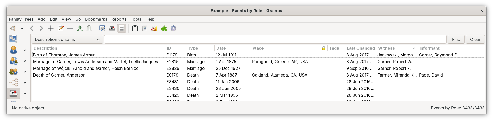
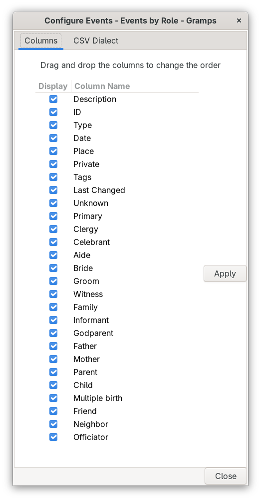
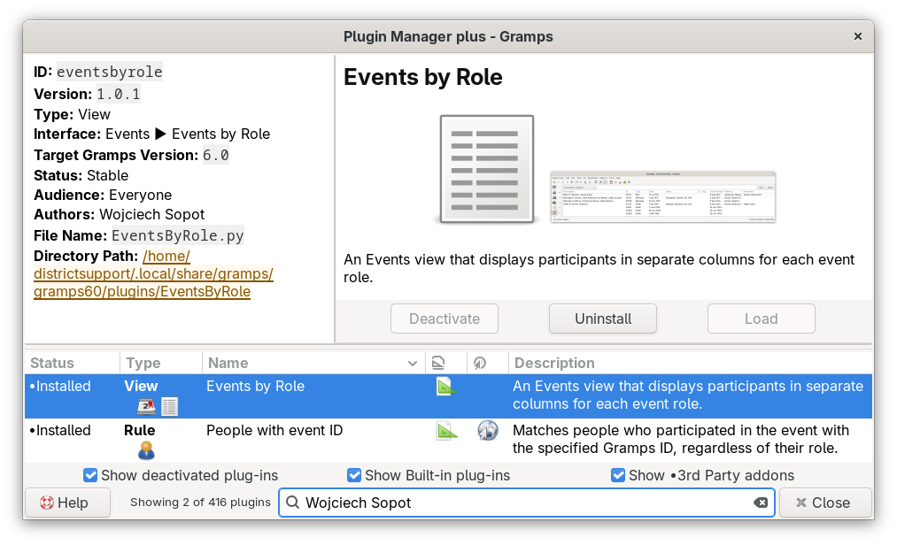

# Events by Role
<!-- undocked=false -->
[README.md](README.md) ● [CHANGELOG.md](CHANGELOG.md)

Welcome to **Events by Role**, a different way to look at the events in your family tree. The usual Events view tells you what happened, when and where. This view also tells you who took part, and in which role: the primary person, the family, the witnesses, the godparents, the informant, and any other role you have used. Every role gets a column of its own, so you can see at a glance who was where.

*The Events by Role view, sorted by the Witness column. The events with witnesses come first.*

## Opening the view
Go to the **Events** category and use the view mode buttons in the toolbar to switch to **Events by Role**. The standard Events view is still there, and you can switch back at any time.

## What the columns show
The first columns are the same as in the standard Events view: Description, ID, Type, Date, Place, Private, Tags and Last Changed. After them comes one column for each event role. The standard Gramps roles come first, followed by the custom roles used in the open tree, in alphabetical order.

A role column lists everyone who took part in the event in that role. Both people and families are included. When more than one participant has the same role, the names are sorted and separated by semicolons. An empty cell means that nobody has that role in the event.

Click a column header to sort by that column. Sorting by a role column is a quick way to find, for example, every event with a godparent. In a very large tree, sorting by a role column can take a little while, because the view looks up the participants of every event.

## Choosing and arranging columns
Few trees use every role, so you will probably want to hide some columns. Choose **Configure...** from the **View** menu, or click the **Configure the active view** button in the toolbar. On the **Columns** tab, clear the check box of each column you want to hide, and drag columns up or down to change their order. Then click **Apply**. To change the width of a column in the view, drag the edge of its header.

*The Columns tab lists the standard columns first, then one column for each role.*

Your column arrangement is kept when the set of roles changes. When you add a new custom role, or open a tree with different custom roles, the columns for roles that are no longer used disappear, and the columns for new roles are added at the end. The order, widths and hidden columns you chose for all other columns stay as they were.

## Filtering
 The filter sidebar works just as it does in the standard Events view, and so do your custom event filters.

## Getting help
 Click the **Help** icon in the toolbar to read this document. When the **Markdown Dash** gramplet is installed and active, the document opens inside Gramps. Otherwise it opens on GitHub in your web browser. The tooltip of the icon tells you which of the two will happen.

## Settings
Events by Role keeps its column arrangement in a file called `EventsByRole.ini` in the folder of the addon. To return to the original arrangement, close Gramps and delete that file.

## Installation
Events by Role works with Gramps 5.2, 6.0 and 6.1. See the [Gramps-filter repository](https://github.com/Rogue05/Gramps-filter) for instructions on adding it with the Addon Manager. After installation, Events by Role is listed in the Plugin Manager as a View in the Events category.

## Credits and license
Events by Role was written by Wojciech Sopot (Rogue05). It is free software, licensed under the GNU General Public License, version 2 or later. See the `LICENSE` file in the repository.

*Events by Role in the Plugin Manager, next to People with event ID, another addon by Wojciech Sopot.*
